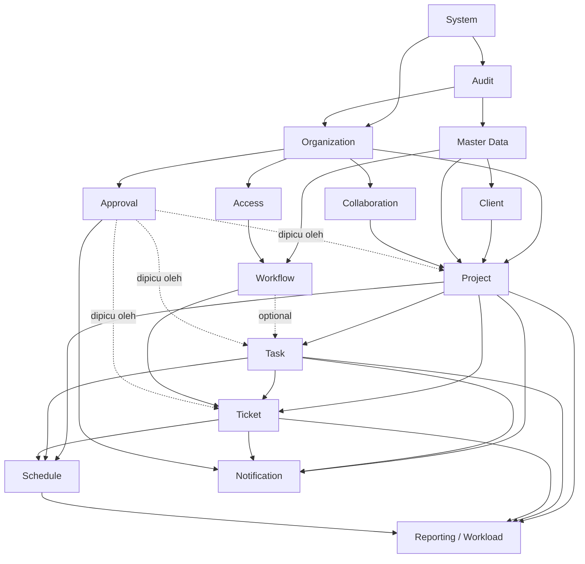
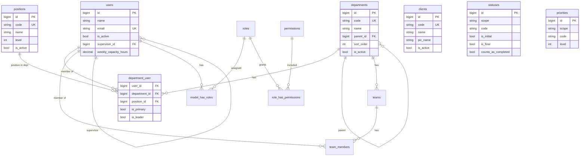
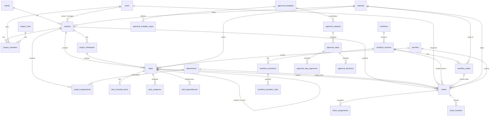
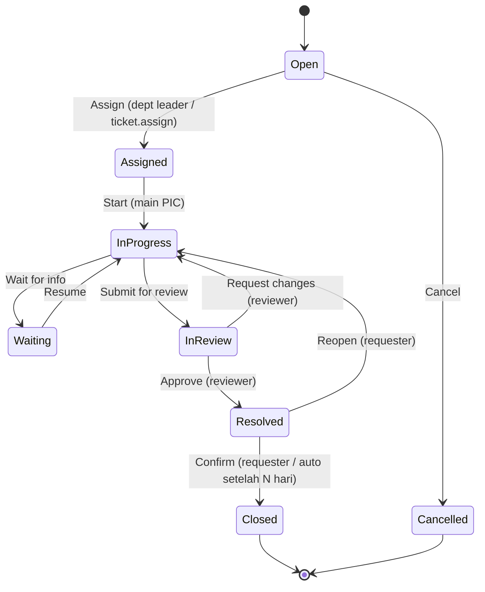

# HarmaWorkspace — Phase 0 Blueprint

**Integrated Work Management System for HARMA DIGITAL**

| | |
|---|---|
| Dokumen | Phase 0 — System Analysis & Foundation Planning |
| Status | Draft untuk review |
| Tanggal | 2026-10-12 |
| Lingkup | Analisis & perencanaan. Tidak ada kode, migration, atau package yang dibuat pada fase ini. |

> Konvensi dokumen: istilah teknis tetap bahasa Inggris (table, migration, policy, dsb). Nama tabel/kolom bersifat **konseptual** dan dapat disesuaikan saat Phase 1 tanpa mengubah prinsip.

---

## Daftar Isi

0. [Analisis Kondisi Saat Ini](#0-analisis-kondisi-saat-ini)
1. [Executive Summary](#1-executive-summary)
2. [System Scope](#2-system-scope)
3. [Actor & Role](#3-actor--role)
4. [Module Architecture](#4-module-architecture)
5. [Domain Relationship](#5-domain-relationship)
6. [Laravel Architecture](#6-laravel-architecture)
7. [Database Concept](#7-database-concept)
8. [ERD](#8-erd)
9. [Master Data](#9-master-data)
10. [Role & Permission](#10-role--permission)
11. [Workflow](#11-workflow)
12. [Approval](#12-approval)
13. [Assignment](#13-assignment)
14. [Deadline & Schedule](#14-deadline--schedule)
15. [UI/UX](#15-uiux)
16. [Pages](#16-pages)
17. [Routes](#17-routes)
18. [Security](#18-security)
19. [Performance](#19-performance)
20. [Risks](#20-risks)
21. [Development Roadmap](#21-development-roadmap)
22. [Recommendations & Open Questions](#22-recommendations--open-questions)

---

## 0. Analisis Kondisi Saat Ini

### 0.1 Existing Structure

| Aspek | Temuan |
|---|---|
| Repository | Hanya `README.md` + 1 commit (`Initial commit`). Belum ada aplikasi Laravel. |
| composer.json / package.json | Belum ada. |
| Routes / migrations / models / controllers / Livewire / Blade | Belum ada. |
| Authentication / permission | Belum ada. |
| Database | Belum ada skema HarmaWorkspace. |

### 0.2 Environment Lokal

| Komponen | Temuan | Catatan |
|---|---|---|
| PHP CLI | 8.4 (Homebrew) | Extension `pdo_mysql`, `intl`, `mbstring`, `bcmath`, `gd`, `zip` tersedia. |
| Composer | 2.8 | OK. |
| Node.js | 23 | OK untuk Vite + Tailwind. |
| MySQL | Listener port 3306 dari **OrbStack** (container) | Gunakan ini sebagai database development. |
| XAMPP | Binary `php`/`mysql` XAMPP gagal dijalankan (`bad CPU type` — build Intel di Apple Silicon tanpa Rosetta) | **Jangan bergantung pada PHP/MySQL XAMPP.** Folder `htdocs` hanya lokasi file. Jalankan app dengan `php artisan serve` / Laravel Herd / Valet. |

### 0.3 Kesimpulan

- Tidak ada fitur lama yang harus dipertahankan → **greenfield**, tidak perlu migration strategy dari sistem lama.
- Risiko conflict hanya di sisi environment (XAMPP vs Homebrew/OrbStack). Disarankan memakai MySQL 8.x (OrbStack) dan PHP 8.4 Homebrew.
- Dokumentasi/guideline AI untuk development akan dikelola dengan **Laravel Boost** (lihat [§22](#22-recommendations--open-questions)).

---

## 1. Executive Summary

HarmaWorkspace adalah aplikasi internal **modular monolith** berbasis Laravel + MySQL + Livewire + Tailwind yang menjadi pusat pengelolaan Project, Task, Ticket, Workflow, Approval, Deadline, dan Workload untuk seluruh divisi HARMA DIGITAL.

Lima keputusan arsitektur inti:

1. **Satu aplikasi Laravel, dipisah per domain.** Business logic tinggal di `app/Domain/<Domain>/Actions` dan dipanggil oleh Livewire (web) maupun API Controller (mobile). Blade/Livewire hanya presentation.
2. **Master-driven.** Status, priority, type, category, department, position, project role berasal dari database. Logic memakai `code`, `level`, dan semantic flag (`is_initial`, `is_final`, `counts_as_completed`), tidak pernah memakai nama tampilan atau ID literal.
3. **Tiga lapis authorization.** Role (Spatie) → Permission (granular) → Resource Scope (Policy + query scope `visibleTo($user)` yang sama untuk list dan detail).
4. **Riwayat tidak pernah hilang.** Assignment, schedule, status, dan approval disimpan sebagai history append-only. Master yang dipakai transaksi di-deactivate, bukan dihapus.
5. **Workflow & approval berversi.** Transaksi mengunci versi workflow/approval saat dibuat, sehingga perubahan konfigurasi tidak merusak data lama.

---

## 2. System Scope

### 2.1 Tujuan

- Satu sumber kebenaran untuk pekerjaan lintas divisi: siapa mengerjakan apa, kapan, dan statusnya.
- Mengurangi koordinasi manual (chat/spreadsheet) untuk request antar divisi melalui Ticket & Department Inbox.
- Memberi visibilitas progres, deadline, dan beban kerja untuk Leader dan Management.

### 2.2 Pengguna

Seluruh karyawan internal HARMA DIGITAL. Akun dibuat oleh administrator (tanpa registrasi publik). Client **tidak** login pada fase awal.

### 2.3 Modul (Target Akhir)

Organization, Master Data, Client, Project (multi-division), Milestone, Task/Subtask/Checklist, Ticket/Helpdesk, Department Inbox, Assignment, Workflow, Approval, Deadline & Schedule, Timeline, Calendar, Gantt, Workload, Dashboard, Reports, Collaboration (comment/attachment/mention), Activity & Audit, Notification, System Settings, REST API, PWA, Mobile.

### 2.4 Batas Sistem (Out of Scope)

| Tidak termasuk | Alasan |
|---|---|
| Client portal / login client | Client hanya reference data di fase awal. |
| Payroll, absensi, HRIS | Domain berbeda; HarmaWorkspace hanya membaca struktur organisasi. |
| Invoicing / finance accounting | Di luar work management. |
| Chat real-time | Komentar + mention sudah cukup; chat bukan tujuan sistem. |
| Time tracking detail (stopwatch) | Dipertimbangkan sebagai opsi di Phase 8 (time log sederhana). |
| Microservices | Tidak diperlukan pada skala internal. |

---

## 3. Actor & Role

Penting: **actor ≠ system role.** Hanya tiga system role yang disimpan di Spatie (`Super Admin`, `Management`, `Staff`). "Project Manager", "Department Leader", "Reviewer", dan "Approver" adalah **peran kontekstual** yang muncul dari data (kolom proyek, flag leader di department, project role, atau approval step).

| Actor | Sumber peran | Tugas utama |
|---|---|---|
| **Super Admin** | System role | Mengelola user, role & permission, master data, workflow, approval template, system settings, audit. Akses penuh. |
| **Management** | System role | Melihat seluruh project/ticket/report, memantau risiko dan performa departemen, approve keputusan strategis. |
| **Staff** | System role (default) | Mengerjakan task/ticket yang di-assign, membuat ticket, update progres, komentar. |
| **Project Owner** | `projects.owner_id` | Sponsor/penanggung jawab bisnis project; approve perubahan scope/jadwal besar. |
| **Project Manager** | `projects.manager_id` | Mengelola project: milestone, task, anggota, departemen pendukung, jadwal, baseline. |
| **Department Leader** | `department_user.is_leader` | Mengelola Department Inbox, assign pekerjaan ke anggota, memantau workload dan overdue tim. |
| **Project Department Lead** | `project_departments.lead_user_id` | Leader departemen dalam konteks satu project; membagi task departemennya di project tsb. |
| **Reviewer** | Project role / workflow rule | Me-review hasil kerja (misal state "In Review"). |
| **Approver** | Approval step | Memberi keputusan approve/reject pada approval request. |
| **Requester** | `tickets.requester_id` | Pembuat ticket; mengonfirmasi resolusi. |
| **Observer** | Project role | Read-only pada project tertentu. |

---

## 4. Module Architecture

### 4.1 Module Map

| Module | Tanggung jawab | Bergantung pada |
|---|---|---|
| **System** | Settings, numbering, navigation registry | — |
| **Audit** | Activity log (user-facing), audit log (teknis) | System |
| **Organization** | User, department, position, team, keanggotaan | System, Audit |
| **Access** | Role, permission, policy helper, visibility scope | Organization |
| **Master Data** | Status, priority, type, category, project role, resolution | Audit |
| **Client** | Master client | Master Data, Audit |
| **Collaboration** | Comment, attachment, mention | Organization, Audit |
| **Project** | Project, project department, member, milestone, baseline | Organization, Client, Master Data, Collaboration |
| **Task** | Task, subtask, checklist, assignee, dependency | Project, Master Data, Collaboration |
| **Ticket** | Ticket, assignment, transfer, relation, Department Inbox | Organization, Client, Project, Task, Master Data, Workflow |
| **Workflow** | Workflow, version, state, transition, rule | Master Data, Access |
| **Approval** | Template, request, step, decision | Organization, Access |
| **Schedule** | Planned/current/actual, schedule change, baseline | Project, Task, Ticket |
| **Notification** | Laravel notifications, preferences | Organization (+ event dari semua modul) |
| **Reporting / Workload** | Read model, agregasi, dashboard | Semua modul (read-only) |

### 4.2 Dependency Diagram



**Aturan dependency:** modul hanya boleh memanggil Action/Query modul di "bawahnya". Komunikasi ke arah sebaliknya (misal Ticket selesai → notifikasi) memakai **Laravel Events**, bukan pemanggilan langsung. Ini mencegah circular dependency.

---

## 5. Domain Relationship

```text
ORGANIZATION (User, Department, Position, Team)
      │
      ├── CLIENT (reference)
      │      │
      │      ▼
      └──► PROJECT ──┬──► PROJECT DEPARTMENT (lead + supporting) ──► department lead
                     ├──► PROJECT MEMBER (project role)
                     ├──► MILESTONE
                     │        │
                     │        ▼
                     ├──► TASK ──► SUBTASK (maks 1 level) ──► CHECKLIST ITEM
                     │      │
                     │      └──► RELATED TICKET (tickets.task_id)
                     │
                     └──► TICKET (tickets.project_id, opsional)

TICKET juga dapat berdiri sendiri (tanpa project), contoh: "HR minta instalasi printer".

WORKFLOW ──► mengatur status Ticket (wajib) dan Task (opsional, Phase 5)
APPROVAL ──► dapat ditempelkan ke Project / Task / Ticket / transition tertentu
```

### 5.1 Aturan Konseptual

| Aturan | Keterangan |
|---|---|
| 1 Project → banyak Task | `tasks.project_id` wajib. |
| 1 Project → banyak Ticket | `tickets.project_id` nullable. |
| 1 Task → banyak related Ticket | `tickets.task_id` nullable; task harus milik project yang sama jika keduanya diisi. |
| Ticket selesai **tidak** otomatis menyelesaikan Task | Hanya memunculkan notifikasi ke PIC task. |
| Task selesai **tidak** otomatis menutup Ticket | Ticket punya lifecycle & requester sendiri. |
| Project selesai **tidak** otomatis menutup Ticket | Penutupan project divalidasi: menampilkan daftar task/ticket yang masih terbuka; PM harus menyelesaikan atau secara eksplisit memindahkan/menutupnya. |
| Subtask maksimal 1 level | `tasks.parent_id` hanya boleh menunjuk task yang `parent_id`-nya null. |
| Milestone milik satu project | Task boleh punya milestone dari project yang sama saja. |

---

## 6. Laravel Architecture

### 6.1 Stack

| Layer | Pilihan | Catatan |
|---|---|---|
| Framework | Laravel versi stabil terbaru saat Phase 1 dimulai (target Laravel 13, PHP ≥ 8.3; lokal PHP 8.4) | Versi dikunci di `composer.lock` saat instalasi. |
| Frontend | Livewire (versi stabil terbaru) + Blade + Tailwind CSS v4 + Alpine.js (bawaan Livewire) | |
| Starter | Laravel Livewire Starter Kit (Fortify-based auth) | Registrasi publik **dinonaktifkan**. |
| UI component | Blade component internal (`resources/views/components/ui/*`), opsional Flux free | Lihat [§22 keputusan D3](#223-keputusan-yang-perlu-dikonfirmasi). |
| Authorization | spatie/laravel-permission + Laravel Policy | |
| API (nanti) | Laravel Sanctum + API Resource, prefix `/api/v1` | Dibuat saat dibutuhkan mobile. |
| Testing | Pest (Feature test prioritas) | |
| Queue | `database` driver di awal → Redis jika volume naik | Untuk notifikasi & email. |
| Dev tooling | **Laravel Boost** (guideline AI + MCP), Laravel Pint | |

### 6.2 Struktur Folder

Pendekatan: **ikuti konvensi Laravel untuk hal yang "framework-shaped"** (Models, Policies, Http, Livewire) agar auto-discovery, factory, dan tooling (Boost, IDE) tetap bekerja; **pisahkan business logic per domain** di `app/Domain`.

```text
app/
├── Domain/                         # Business logic per domain (reusable web + API)
│   ├── Organization/
│   │   ├── Actions/                # CreateUser, UpdateUser, DeactivateUser, SyncUserDepartments
│   │   ├── Data/                   # DTO input (readonly class)
│   │   ├── Queries/                # Query object untuk list/filter kompleks
│   │   └── Rules/                  # Definisi validation rules bersama (FormRequest + Livewire Form)
│   ├── Access/                     # Permission registry, visibility scope helper
│   ├── MasterData/                 # Concerns master (HasMasterAttributes), Actions activate/deactivate
│   ├── Client/
│   ├── Project/                    # (Phase 2)
│   ├── Task/                       # (Phase 3)
│   ├── Ticket/                     # (Phase 4)
│   ├── Workflow/                   # (Phase 5) WorkflowEngine, TransitionAction
│   ├── Approval/                   # (Phase 5)
│   ├── Schedule/                   # (Phase 6)
│   ├── Collaboration/
│   ├── Audit/                      # ActivityLogger, AuditRecorder
│   └── System/                     # Settings, NumberGenerator, Navigation
├── Models/                         # Semua Eloquent model (flat) + Concerns/ (trait)
├── Policies/                       # Policy per model (auto-discovered)
├── Enums/                          # HANYA enum teknis (AssignmentRole, ApprovalStatus, DependencyType, ...)
├── Http/
│   ├── Controllers/
│   │   ├── Web/                    # Controller tipis (download file, redirect, dsb)
│   │   └── Api/V1/                 # (nanti) REST API
│   ├── Requests/                   # Form Request (memakai Domain/*/Rules)
│   ├── Resources/                  # (nanti) API Resource
│   └── Middleware/                 # EnsureUserIsActive, dll
├── Livewire/                       # Komponen per area UI
│   ├── Dashboard/
│   ├── Organization/
│   ├── MasterData/
│   ├── Clients/
│   └── Admin/
├── Notifications/
├── Events/ & Listeners/            # Event lintas modul
└── Providers/

config/
└── navigation.php                  # Definisi sidebar: label, route, icon, permission, state (available|coming_soon)

resources/views/
├── components/
│   ├── layouts/                    # app (sidebar+topbar), guest (auth)
│   └── ui/                         # button, input, select, badge, table, modal, drawer, empty-state, page-header
└── livewire/...

database/
├── migrations/
├── factories/
└── seeders/
    ├── System/                     # Data default produksi (permission, role, master default, super admin)
    └── Development/                # Data dummy (user demo, client demo) — tidak pernah dijalankan di production

docs/                               # Blueprint & keputusan arsitektur
.ai/guidelines/                     # Custom guideline Laravel Boost (aturan proyek untuk AI agent)
```

### 6.3 Alur Request

```text
Livewire Component / API Controller
        │  (validasi: Livewire Form / FormRequest → memakai Domain/*/Rules yang sama)
        │  (authorize: Policy)
        ▼
Domain Action  (DB::transaction, business rule, dispatch event, catat audit)
        ▼
Eloquent Model
```

| Prinsip | Implementasi |
|---|---|
| Controller/Livewire tipis | Hanya: validate → authorize → panggil Action → render/redirect. |
| Satu sumber validation | `Domain/<X>/Rules/<Entity>Rules` dipakai FormRequest dan Livewire Form, mencegah duplikasi. |
| Satu sumber visibility | `Model::scopeVisibleTo(User)` dipakai list query; Policy `view()` memakai logic yang sama. |
| Transaction | Semua Action yang menulis > 1 tabel. |
| Enum | Hanya nilai teknis yang tidak boleh diubah admin (lihat [§9.3](#93-enum-teknis-bukan-master)). |
| Kenapa bukan `app/Modules/*` penuh (nwidart dsb) | Menambah kompleksitas service provider, autoload, dan melawan konvensi Laravel; manfaatnya baru terasa di tim besar. `app/Domain` sudah memberi pemisahan logic yang cukup. |

---

## 7. Database Concept

### 7.1 Prinsip

- MySQL 8, InnoDB, `utf8mb4` / `utf8mb4_unicode_ci`.
- Primary key `bigint unsigned` auto increment. Kode bisnis (nomor ticket dsb) disimpan di kolom terpisah dengan unique index.
- Foreign key pada semua relasi transaksional. `ON DELETE RESTRICT` sebagai default (karena master/transaksi tidak di-hard delete); `CASCADE` hanya untuk child murni (checklist item, pivot).
- Tabel log (activity/audit) **tanpa FK** dan append-only — demi kecepatan tulis dan agar log tetap ada apa pun yang terjadi pada entitas.
- JSON hanya untuk data yang memang tidak relasional: nilai lama/baru di audit, payload notifikasi, snapshot.

### 7.2 Pola Kolom Master

```text
id, code (unique, immutable setelah dipakai), name, description,
sort_order, is_active, archived_at (nullable), created_at, updated_at
```

Tambahan sesuai kebutuhan: `color`, `icon`, `level`, dan semantic flag.

- `is_active = false` → tidak muncul di pilihan form baru, tetap tampil di data lama.
- `archived_at` → disembunyikan juga dari daftar master default (filter "Archived").
- `code` dikunci (read-only di UI) setelah master dipakai transaksi, karena logic dapat bergantung padanya.

### 7.3 Daftar Tabel per Grup

Kolom `id`, `created_at`, `updated_at` diasumsikan ada di semua tabel kecuali disebut lain. **Fase** = fase saat tabel dibuat.

#### Organization & Access

| Tabel | Fungsi | Kolom kunci / FK | Fase |
|---|---|---|---|
| `users` | Akun karyawan | `name`, `email` (unique), `password`, `employee_code` (unique, nullable), `phone`, `avatar_path`, `is_active`, `supervisor_id` → users (nullable), `weekly_capacity_hours` (nullable; default dari setting), `last_login_at`, `deactivated_at`, `deactivated_by` | 1 |
| `departments` | Divisi | master + `parent_id` → departments (nullable) | 1 |
| `positions` | Jabatan | master + `level` | 1 |
| `department_user` | Keanggotaan user ↔ department (M:N) | `user_id`, `department_id`, `position_id` (nullable), `is_primary`, `is_leader`, `joined_at`; unique (`user_id`,`department_id`); maksimal satu primary per user (lihat §7.5) | 1 |
| `teams` | Tim di dalam department | master + `department_id`, `leader_id` → users | 1 (opsional, lihat D5) |
| `team_members` | Anggota tim | `team_id`, `user_id`; unique pair | 1 (opsional) |
| `roles`, `permissions`, `model_has_roles`, `model_has_permissions`, `role_has_permissions` | Spatie | standar package | 1 |
| `password_reset_tokens`, `sessions` | Laravel | standar | 1 |

#### System & Audit

| Tabel | Fungsi | Kolom kunci | Fase |
|---|---|---|---|
| `settings` | Konfigurasi sistem key-value bertipe | `group`, `key` (unique per group), `value`, `type` (string/int/bool/json) | 1 |
| `number_sequences` | Counter penomoran | `scope` (project/task/ticket), `period` (mis. `2026`), `last_number`; unique (`scope`,`period`) | 1 (struktur), dipakai Phase 2 |
| `activity_logs` | Riwayat ramah-user | `subject_type`, `subject_id`, `actor_id`, `event` (code), `description`, `properties` (json), `created_at` | 1 |
| `audit_logs` | Audit teknis | `auditable_type`, `auditable_id`, `actor_id`, `event` (created/updated/deactivated/...), `old_values` (json), `new_values` (json), `ip_address`, `user_agent`, `created_at` | 1 |

#### Master Data

| Tabel | Fungsi | Kolom tambahan | Fase |
|---|---|---|---|
| `statuses` | Status semua domain | `scope` (project/task/ticket), `color`, `icon`, `is_initial`, `is_final`, `is_closed`, `counts_as_completed`; unique (`scope`,`code`) | 1 |
| `priorities` | Priority semua domain | `scope`, `level`, `color`, `icon`; unique (`scope`,`code`) | 1 |
| `project_categories` | Kategori project | `color` | 1 (master) |
| `project_roles` | Peran anggota project | flag: `can_manage_tasks`, `can_review`, `can_approve`, `is_read_only` | 1 (master) |
| `project_tags` + `project_tag` | Tag project | `color` | 2 |
| `task_types` | Jenis task (Feature, Bug Fix, Design, ...) | `color`, `icon` | 1 (master) |
| `ticket_types` | Bug, Incident, Request, Question, ... | `workflow_id` (nullable sampai Phase 5), `default_priority_id` | 1 (master) |
| `ticket_categories` | Kategori ticket | `ticket_type_id` (nullable), `default_department_id` → departments | 1 (master) |
| `resolutions` | Hasil penyelesaian ticket (Fixed, Won't Fix, Duplicate, ...) | `counts_as_resolved` | 1 (master) |
| `clients` | Master client | `code`, `name`, `pic_name`, `phone`, `email`, `address`, `notes`, `is_active`, `archived_at` | 1 |

> Mengapa `statuses` dan `priorities` digabung per `scope` padahal prinsipnya "jangan tabel master generik": lihat [§9.2](#92-keputusan-statuses--priorities-per-scope).

#### Project (Phase 2)

| Tabel | Fungsi | Kolom kunci / FK |
|---|---|---|
| `projects` | Project | `number` (unique), `name`, `description`, `client_id`, `project_category_id`, `status_id`, `priority_id`, `owner_id` → users, `manager_id` → users, `visibility` (enum teknis: members/internal), `planned_start/end`, `current_start/end`, `actual_start/end`, `progress` (cache), `completed_at`, `archived_at`, soft delete |
| `project_departments` | Department yang terlibat | `project_id`, `department_id`, `is_lead`, `lead_user_id` → users; unique (`project_id`,`department_id`); maksimal satu lead per project |
| `project_members` | Anggota project | `project_id`, `user_id`, `project_role_id`, `project_department_id` (nullable), `joined_at`, `left_at`; unique aktif (`project_id`,`user_id`) |
| `project_milestones` | Milestone | `project_id`, `name`, `sort_order`, planned/current/actual start/end, `completed_at` |
| `project_baselines` | Snapshot rencana (re-baseline) | `project_id`, `version`, `name`, `reason`, `created_by` |
| `project_baseline_items` | Isi snapshot | `baseline_id`, `schedulable_type`, `schedulable_id`, `start`, `end` |

#### Task (Phase 3)

| Tabel | Fungsi | Kolom kunci / FK |
|---|---|---|
| `tasks` | Task & subtask | `number` (unique), `project_id`, `milestone_id` (nullable), `parent_id` → tasks (nullable, maks 1 level), `department_id`, `task_type_id`, `status_id`, `priority_id`, `workflow_version_id`/`workflow_state_id` (nullable, Phase 5), `title`, `description`, planned/current/actual start/end, `estimated_hours`, `progress`, `completed_at`, `lock_version`, soft delete |
| `task_assignees` | Main PIC + collaborator + history | `task_id`, `user_id`, `role` (enum teknis: main/collaborator), `assigned_by`, `assigned_at`, `unassigned_at`, `unassigned_by`, `reason`; maksimal satu main aktif |
| `task_checklist_items` | Checklist | `task_id` (cascade), `title`, `is_done`, `done_by`, `done_at`, `sort_order` |
| `task_dependencies` | Dependency antar task | `predecessor_id`, `successor_id`, `type` (enum teknis FS/SS/FF/SF), `lag_days`; unique pair; tanpa siklus |
| `task_status_histories` | Riwayat status (untuk cycle time) | `task_id`, `from_status_id`, `to_status_id`, `changed_by`, `note`, `created_at` |

#### Ticket (Phase 4)

| Tabel | Fungsi | Kolom kunci / FK |
|---|---|---|
| `tickets` | Ticket | `number` (unique), `title`, `description`, `ticket_type_id`, `ticket_category_id`, `priority_id`, `status_id` (denormalisasi dari state), `workflow_version_id`, `workflow_state_id`, `requester_id`, `requester_department_id`, `target_department_id`, `project_id` (nullable), `task_id` (nullable), `client_id` (nullable), `resolution_id` (nullable), `due_at`, `first_response_at`, `resolved_at`, `closed_at`, `lock_version`, soft delete |
| `ticket_assignments` | Main PIC + collaborator + history | sama seperti `task_assignees` |
| `ticket_transfers` | Perpindahan antar department | `ticket_id`, `from_department_id`, `to_department_id`, `reason`, `transferred_by`, `created_at` |
| `ticket_relations` | Relasi ticket ↔ ticket | `ticket_id`, `related_ticket_id`, `type` (enum teknis: relates/duplicates/blocks) |
| `ticket_status_histories` | Riwayat transisi | `ticket_id`, `from_state_id`, `to_state_id`, `transition_id`, `changed_by`, `comment`, `created_at` |

#### Workflow & Approval (Phase 5)

| Tabel | Fungsi | Kolom kunci / FK |
|---|---|---|
| `workflows` | Definisi workflow | master + `applies_to` (enum teknis: ticket/task) |
| `workflow_versions` | Versi | `workflow_id`, `version`, `state` (draft/published/retired), `published_at`, `published_by`; unique (`workflow_id`,`version`) |
| `workflow_states` | Node | `workflow_version_id`, `status_id` → statuses, `code`, `name`, `is_initial`, `sort_order`, posisi diagram (opsional) |
| `workflow_transitions` | Edge | `workflow_version_id`, `from_state_id`, `to_state_id`, `code`, `name`, `requires_comment`, `approval_template_id` (nullable) |
| `workflow_transition_rules` | Guard | `transition_id`, `rule_type` (enum teknis), `rule_value` |
| `approval_templates` | Template | master + `applies_to` |
| `approval_template_steps` | Langkah template | `template_id`, `step_order`, `name`, `approver_type` (enum teknis), `approver_value`, `decision_rule` (any/all), `allow_self_approval` (default false) |
| `approval_requests` | Instance approval | `approvable_type`, `approvable_id`, `template_id`, `status` (enum teknis), `requested_by`, `current_step_order`, `completed_at`, `lock_version` |
| `approval_steps` | Snapshot langkah | `approval_request_id`, `step_order`, `name`, `decision_rule`, `status`, `completed_at` |
| `approval_step_approvers` | Approver ter-resolve | `approval_step_id`, `user_id`; unique pair |
| `approval_decisions` | Keputusan | `approval_step_id`, `user_id`, `decision` (approve/reject), `comment`, `created_at`; unique (`approval_step_id`,`user_id`) |

#### Collaboration, Schedule, Notification

| Tabel | Fungsi | Kolom kunci | Fase |
|---|---|---|---|
| `comments` | Komentar polymorphic | `commentable_type/id`, `user_id`, `parent_id`, `body`, `edited_at`, soft delete | 2 |
| `mentions` | Mention di komentar | `comment_id`, `user_id` | 2 |
| `attachments` | File polymorphic | `attachable_type/id`, `disk`, `path`, `original_name`, `mime_type`, `size`, `uploaded_by`, soft delete | 2 |
| `schedule_changes` | Riwayat perubahan jadwal | `schedulable_type/id`, `field`, `old_value`, `new_value`, `reason`, `changed_by`, `created_at` | 2 (project), 3 (task) |
| `notifications` | Laravel notifications | standar (uuid) | 2 |
| `notification_preferences` | Preferensi | `user_id`, `event`, `channel`, `enabled`; unique triple | 6 |

### 7.4 Cardinality Ringkas

| Relasi | Cardinality |
|---|---|
| User ↔ Department | M:N via `department_user` (1 primary per user) |
| Department → Department (parent) | 1:N self |
| Department → Team | 1:N |
| User → User (supervisor) | N:1 self |
| Client → Project / Ticket | 1:N |
| Project ↔ Department | M:N via `project_departments` (1 lead) |
| Project ↔ User | M:N via `project_members` (+ owner, manager 1:1) |
| Project → Milestone / Task / Ticket | 1:N |
| Task → Subtask | 1:N (maks 1 level) |
| Task ↔ Task (dependency) | M:N self via `task_dependencies` |
| Task → Ticket (related) | 1:N |
| Task / Ticket ↔ User (assignment) | M:N dengan history |
| Workflow → Version → State/Transition | 1:N:N |
| Ticket → Workflow Version (terkunci) | N:1 |
| Approval Template → Request → Step → Decision | 1:N:N:N |
| Project / Task / Ticket → Comment, Attachment, Activity, Schedule Change | 1:N polymorphic |

### 7.5 Constraint Penting

| Aturan | Cara enforce |
|---|---|
| Satu primary department per user | Generated column `primary_marker = IF(is_primary, 1, NULL)` + unique (`user_id`, `primary_marker`). MySQL mengizinkan banyak NULL di unique index. Juga divalidasi di Action. |
| Satu lead department per project | Pola sama di `project_departments`. |
| Satu main PIC aktif per task/ticket | Generated column `active_main_marker = IF(role='main' AND unassigned_at IS NULL, 1, NULL)` + unique (`task_id`, `active_main_marker`). |
| Scope status sesuai entitas (task tidak boleh memakai status ticket) | Divalidasi di Action + Rule (`exists` dengan `where scope`). Hardening opsional: composite FK (`status_scope`, `status_id`) dengan generated constant column. |
| Subtask maks 1 level, dependency tanpa siklus | Divalidasi di Action (cek parent, DFS graph per project) + test. |
| Nomor tidak digunakan ulang | Unique index pada `number` + soft delete (nomor tetap terpakai) + `number_sequences` tidak pernah turun. |

### 7.6 Polymorphic Relation (comments, attachments, activity_logs, mentions, schedule_changes)

| | Polymorphic (`*_type`, `*_id`) | Tabel terpisah per entitas (`project_comments`, `task_comments`, ...) |
|---|---|---|
| Jumlah tabel | 1 per fitur | 3–4 per fitur |
| Kode | 1 model, 1 komponen UI, 1 policy | Duplikasi |
| FK ke parent | ✗ tidak bisa | ✓ |
| Menambah entitas baru (mis. Approval) | Tanpa migration | Migration + model baru |
| Query lintas entitas ("aktivitas terbaru saya") | Mudah | UNION |

**Keputusan: polymorphic**, dengan mitigasi:

1. `Relation::enforceMorphMap()` → nilai `*_type` berupa alias stabil (`project`, `task`, `ticket`, `approval_request`), bukan nama class. Refactor namespace tidak merusak data.
2. Composite index (`*_type`, `*_id`, `created_at`).
3. Integritas dijaga di aplikasi: parent tidak pernah di-hard delete (soft delete), sehingga orphan tidak terjadi.
4. Otorisasi selalu lewat parent: "boleh lihat komentar" = "boleh lihat parent".

Untuk relasi inti (task → project, ticket → task) **tetap FK biasa**, bukan polymorphic.

### 7.7 Index Plan

Index hanya untuk pola query nyata:

| Tabel | Index | Alasan |
|---|---|---|
| `users` | unique `email`; `is_active` | Login; filter user aktif. |
| `department_user` | unique (`user_id`,`department_id`); (`department_id`,`is_leader`) | Anggota departemen; cari leader. |
| master (semua) | unique `code` (atau (`scope`,`code`)); (`is_active`,`sort_order`) | Dropdown aktif terurut. |
| `projects` | unique `number`; `status_id`; `manager_id`; `client_id`; (`completed_at`,`current_end`) | Filter list; "project aktif mendekati deadline". |
| `project_members` | (`user_id`,`project_id`) | Visibility "project saya". |
| `tasks` | unique `number`; (`project_id`,`status_id`); (`department_id`,`completed_at`); `milestone_id`; `parent_id`; (`completed_at`,`current_end`) | Board per project; workload departemen; overdue. |
| `task_assignees` | (`user_id`,`unassigned_at`,`task_id`) | "My Tasks" (assignment aktif). |
| `tickets` | unique `number`; (`target_department_id`,`closed_at`); (`requester_id`); (`project_id`); (`task_id`); (`status_id`); (`closed_at`,`due_at`) | Department Inbox; "tiket saya"; overdue. |
| `ticket_assignments` | (`user_id`,`unassigned_at`,`ticket_id`) | "My Tickets". |
| polymorphic tables | (`*_type`,`*_id`,`created_at`) | Timeline per entitas. |
| `activity_logs` | (`actor_id`,`created_at`); `created_at` | Aktivitas user; pruning. |
| `audit_logs` | (`auditable_type`,`auditable_id`); `created_at` | Audit per entitas; pruning. |
| `approval_step_approvers` | (`user_id`,`approval_step_id`) | "My Approvals". |

> Kolom `completed_at` / `closed_at` sengaja didenormalisasi (diisi saat transisi ke status final) supaya query "pekerjaan terbuka" cukup `WHERE completed_at IS NULL` tanpa join ke `statuses`.

### 7.8 Soft Delete vs Deactivate / Archive

| Entitas | Kebijakan | Alasan |
|---|---|---|
| Semua master (department, position, status, priority, type, category, project role, resolution, client) | **Deactivate / Archive.** Hard delete hanya jika belum pernah dipakai, dan hanya oleh pemegang permission manage. | Data transaksi lama harus valid. |
| `users` | **Deactivate** (tidak pernah dihapus) | Riwayat assignment/audit merujuk user. |
| `roles` | Hapus hanya jika tidak dipakai user; role sistem (Super Admin) dikunci | Mencegah kehilangan akses. |
| `projects` | **Archive** (`archived_at`) + soft delete untuk salah input | Project selesai tetap dapat dilihat di report. |
| `tasks`, `tickets` | **Soft delete** (dengan permission khusus) | Nomor tetap terpakai; dapat dipulihkan. |
| `comments`, `attachments` | **Soft delete** (tampil "komentar dihapus") | Menjaga konteks diskusi. |
| `task_checklist_items` | Hard delete | Child murni, tercatat di activity. |
| Workflow / approval template | **Versi retired**, tidak dihapus jika ada transaksi | Versioning. |
| History tables (assignment, schedule, status, transfer, decision, log) | **Tidak pernah dihapus/diubah** | Append-only. |

---

## 8. ERD

### 8.1 Phase 1 (detail)



### 8.2 Konseptual (seluruh sistem)



Polymorphic (tidak digambar sebagai FK): `comments`, `attachments`, `mentions`, `activity_logs`, `audit_logs`, `schedule_changes`, `approval_requests.approvable` → project / task / ticket.

---

## 9. Master Data

### 9.1 Master Data Mapping

| Grup | Master | Atribut khusus | Fase aktif |
|---|---|---|---|
| **Organization** | Department | `parent_id` | 1 |
| | Position | `level` | 1 |
| | Team | `department_id`, `leader_id` | 1 (opsional) |
| **Client** | Client | PIC, kontak | 1 |
| **Project** | Project Category | `color` | 1 (master), dipakai 2 |
| | Project Status (`statuses` scope=project) | semantic flags | 1 / 2 |
| | Project Priority (`priorities` scope=project) | `level` | 1 / 2 |
| | Project Role | `can_manage_tasks`, `can_review`, `can_approve`, `is_read_only` | 1 / 2 |
| | Project Tag | `color` | 2 |
| **Task** | Task Type | `color`, `icon` | 1 / 3 |
| | Task Status (scope=task) | semantic flags | 1 / 3 |
| | Task Priority (scope=task) | `level` | 1 / 3 |
| **Ticket** | Ticket Type | `workflow_id`, `default_priority_id` | 1 / 4 |
| | Ticket Category | `default_department_id` | 1 / 4 |
| | Ticket Status (scope=ticket) | semantic flags | 1 / 4 |
| | Ticket Priority (scope=ticket) | `level` (+ target SLA nanti) | 1 / 4 |
| | Resolution | `counts_as_resolved` | 1 / 4 |
| **Workflow** | Workflow, Approval Template | versi, step | 5 |
| **System** | Settings (numbering prefix, kapasitas default, timezone, dsb.) | typed key-value | 1 |

Phase 1 cukup menyiapkan **CRUD master yang generik secara UI** (satu pola tabel + form) sehingga master Project/Task/Ticket bisa diaktifkan bertahap tanpa membangun ulang UI.

### 9.2 Keputusan: `statuses` & `priorities` per scope

Brief melarang satu tabel `master_data` raksasa. Keputusan yang diambil:

- **Digabung (dengan kolom `scope`)**: `statuses`, `priorities`. Strukturnya identik di semua domain, dan workflow state perlu satu FK ke status (lihat §11). Jika dipisah menjadi `task_statuses` / `ticket_statuses`, `workflow_states` tidak bisa punya FK yang valid tanpa kolom nullable ganda.
- **Dipisah per domain**: type, category, project role, resolution, client, department, position. Atributnya berbeda dan relasinya spesifik.

Ini bukan tabel generik: tiap tabel tetap satu konsep dengan kolom yang bermakna dan FK nyata. Di UI, Master Data Center tetap menampilkan "Task Status", "Ticket Status", dan seterusnya sebagai kartu terpisah (filter `scope`).

Alternatif yang ditolak: tabel per domain (`task_statuses`, dst.). Lebih "murni", tetapi menggandakan logic workflow dan reporting lintas domain.

### 9.3 Enum teknis (bukan master)

Hanya untuk nilai yang **mengubah perilaku kode** dan tidak boleh diubah admin:

| Enum | Nilai |
|---|---|
| `MasterScope` | project, task, ticket |
| `AssignmentRole` | main, collaborator |
| `DependencyType` | FS, SS, FF, SF |
| `TicketRelationType` | relates, duplicates, blocks |
| `WorkflowVersionState` | draft, published, retired |
| `TransitionRuleType` | permission, main_pic, requester, department_leader, project_role, project_manager |
| `ApproverType` | user, project_role, department_leader, requester_supervisor, permission, project_manager |
| `ApprovalStatus` | pending, approved, rejected, cancelled |
| `ProjectVisibility` | members, internal |

### 9.4 Default Master (System Seeder)

Contoh. Semua nama dapat diubah admin; `code` yang dipakai logic dikunci.

| Master | Default (code → name) |
|---|---|
| Ticket status | `OPEN` Open (initial), `ASSIGNED` Assigned, `IN_PROGRESS` In Progress, `WAITING` Waiting, `IN_REVIEW` In Review, `RESOLVED` Resolved (final, completed), `CLOSED` Closed (final, closed, completed), `CANCELLED` Cancelled (final, closed, tidak completed) |
| Task status | `TODO` (initial), `IN_PROGRESS`, `IN_REVIEW`, `BLOCKED`, `DONE` (final, completed), `CANCELLED` (final) |
| Project status | `PLANNING` (initial), `ACTIVE`, `ON_HOLD`, `COMPLETED` (final, completed), `CANCELLED` (final) |
| Priority (tiap scope) | `LOW` 10, `NORMAL` 20, `HIGH` 30, `CRITICAL` 40 |
| Position | `STAFF` 10, `SUPERVISOR` 20, `COORDINATOR` 30, `MANAGER` 40, `HEAD` 50 |
| Project role | `DEPT_LEAD`, `MEMBER`, `REVIEWER`, `APPROVER`, `OBSERVER` |

Department contoh (Technical Support, Programmer, QA, UI/UX, Finance, HR, Operational, Management) masuk **Development seeder**, bukan System seeder. Di production, department diinput admin.

---

## 10. Role & Permission

### 10.1 Prinsip

- Kode **selalu** memeriksa permission (`$user->can('ticket.assign')`) atau Policy, tidak pernah nama role.
- Satu-satunya pengecualian: `Gate::before` memberi akses penuh kepada role Super Admin. Nama role diambil dari `config('access.super_admin_role')`, bukan string tersebar.
- Permission didefinisikan di satu **Permission Registry** (kode), lalu disinkronkan oleh seeder. Admin mengatur **role ↔ permission** lewat UI, tetapi tidak membuat permission baru, karena permission tanpa kode yang memeriksanya tidak berarti apa-apa.
- Konvensi nama: `<module>.<action>`. Suffix `.view-all` = melewati resource scope.

### 10.2 Permission Registry

| Module | Permission |
|---|---|
| Dashboard | `dashboard.view` |
| User | `user.view`, `user.create`, `user.update`, `user.disable`, `user.reset-password` |
| Department | `department.view`, `department.manage` |
| Position / Team | `position.manage`, `team.manage` |
| Client | `client.view`, `client.manage` |
| Master Data | `master-data.view`, `master-data.manage` |
| Role & Permission | `role.view`, `role.manage` |
| Settings | `settings.manage` |
| Audit | `audit.view` |
| Project (P2) | `project.view`, `project.view-all`, `project.create`, `project.update`, `project.archive`, `project.manage-members` |
| Task (P3) | `task.view`, `task.view-all`, `task.create`, `task.update`, `task.assign`, `task.delete` |
| Ticket (P4) | `ticket.view`, `ticket.view-all`, `ticket.create`, `ticket.update`, `ticket.assign`, `ticket.transfer`, `ticket.close`, `ticket.delete` |
| Workflow / Approval (P5) | `workflow.manage`, `approval-template.manage` |
| Report (P9) | `report.view`, `report.view-all`, `report.export` |

> Permission seperti `task.update` hanya membuka **kemungkinan**. Policy tetap mengecek scope (misal: hanya PIC, PM, atau leader departemen task tersebut).

### 10.3 Role & Permission Matrix

Legenda: ✓ penuh · **S** = dalam scope sendiri (lihat §10.4) · R = read-only · — tidak ada.
Kolom PM dan Dept Leader adalah **peran kontekstual**: user dengan system role Staff yang menjadi PM/leader mendapat kemampuan itu hanya pada resource terkait.

| Module | Super Admin | Management | Project Manager* | Dept Leader* | Staff |
|---|---|---|---|---|---|
| Dashboard | ✓ | ✓ | ✓ | ✓ | ✓ |
| User management | ✓ | R | — | R (anggota dept) | — |
| Department / Position / Team | ✓ | R | R | R | R |
| Client | ✓ | ✓ | R | R | R |
| Master Data | ✓ | R | R | R | — |
| Role & Permission | ✓ | — | — | — | — |
| System Settings | ✓ | — | — | — | — |
| Audit Log | ✓ | R | — | — | — |
| Project — lihat | ✓ | ✓ (view-all) | S | S (dept terlibat) | S (member) |
| Project — buat | ✓ | ✓ | ✓** | ✓** | — |
| Project — kelola anggota/jadwal | ✓ | — | S | S (bagian dept) | — |
| Task — lihat | ✓ | ✓ | S (project) | S (dept) | S (project member) |
| Task — buat/assign | ✓ | — | S | S (dept) | S (subtask milik sendiri) |
| Task — update progres | ✓ | — | S | S | S (PIC/collaborator) |
| Ticket — buat | ✓ | ✓ | ✓ | ✓ | ✓ |
| Ticket — lihat | ✓ | ✓ | S (project) | S (inbox dept) | S (requester/assignee) |
| Ticket — assign/transfer | ✓ | — | S (project) | S (inbox dept) | — |
| Ticket — close | ✓ | — | S | S | S (requester konfirmasi / PIC sesuai workflow) |
| Approval — decide | ✓*** | S | S | S | S (jika jadi approver) |
| Workflow / Approval template | ✓ | — | — | — | — |
| Reports | ✓ | ✓ (view-all) | S (project) | S (dept) | S (milik sendiri) |

\* Kontekstual. \*\* Jika diberi permission `project.create` melalui role. \*\*\* Super Admin tidak otomatis approve atas nama orang lain; hanya dapat *override* dengan alasan tercatat (opsional, P5).

### 10.4 Data Visibility Rules (Resource Scope)

| Resource | Dapat melihat jika salah satu terpenuhi |
|---|---|
| **Project** | `project.view-all` · owner · manager · anggota aktif `project_members` · leader dari department yang terlibat · `visibility = internal` (semua user aktif dapat melihat ringkasan) |
| **Milestone** | Sama dengan project-nya |
| **Task** | `task.view-all` · dapat melihat project-nya **dan** salah satu: PM/owner, anggota project, leader dept task, assignee aktif/historis |
| **Subtask / Checklist** | Sama dengan parent task |
| **Ticket** | `ticket.view-all` · requester · assignee aktif/historis · anggota `target_department` (Department Inbox) · leader `requester_department` · PM project terkait |
| **Approval request** | requester · approver step mana pun · yang dapat melihat entitas approvable-nya |
| **Comment / Attachment / Activity** | Sama dengan parent entity |
| **User directory** | Semua user aktif melihat nama, avatar, dan department (untuk assign/mention). Detail (email, role, status) butuh `user.view`. |
| **Audit log** | Hanya `audit.view` |
| **Workload** | Diri sendiri · leader untuk anggota department · `report.view-all` |

Implementasi: setiap model punya `scopeVisibleTo(User $user)` dan Policy `view()` yang memanggil logika yang sama, sehingga list, detail, search, export, dan API selalu konsisten. Ini sekaligus perlindungan dari **ID manipulation** (akses `/tickets/123` milik orang lain → 403/404).

---

## 11. Workflow

### 11.1 Konsep

```text
Workflow (mis. "Ticket Standard")
  └── Workflow Version (v1 published, v2 draft)
        ├── States      (OPEN, ASSIGNED, IN_PROGRESS, IN_REVIEW, RESOLVED, CLOSED)
        │     └── status_id → statuses (semantic flags dipakai reporting)
        └── Transitions (OPEN→ASSIGNED "Assign", IN_REVIEW→IN_PROGRESS "Request Changes", ...)
              └── Rules (siapa boleh: permission / main PIC / requester / dept leader / project role)
```



### 11.2 Aturan

| Aturan | Detail |
|---|---|
| State ≠ Status | State adalah node dalam satu versi workflow. Status adalah master global dengan semantic flag. Banyak workflow boleh memetakan state-nya ke status yang sama, sehingga report lintas workflow tetap konsisten. |
| Versioning | Hanya versi `published` yang dipakai transaksi baru. Ticket menyimpan `workflow_version_id` saat dibuat dan terus memakai versi itu. Versi published bersifat **immutable**; perubahan = buat versi baru (clone → edit draft → publish). |
| Migrasi versi (opsional) | Admin dapat memindahkan ticket terbuka ke versi baru melalui state mapping eksplisit; tercatat di audit. |
| Validasi publish | Tepat satu initial state; minimal satu state final; semua state terjangkau; tidak ada transisi yang menunjuk state versi lain. |
| Eksekusi | Satu entry point `TransitionAction` (domain Workflow): cek transisi valid dari state saat ini → evaluasi rules → `requires_comment` → approval (jika ada, transisi tertunda sampai approved) → update `workflow_state_id`, `status_id`, `completed_at/closed_at` → tulis status history + activity → dispatch event. Seluruhnya dalam satu transaction dengan optimistic lock (`lock_version`). |
| Task | Phase 3 memakai transisi sederhana berbasis `statuses` scope task (semua status boleh dipilih kecuali aturan dasar). Phase 5 membuat workflow opsional untuk task type tertentu. |
| Ticket type → workflow | `ticket_types.workflow_id`; ticket baru memakai versi published terbaru dari workflow tersebut. |

---

## 12. Approval

### 12.1 Konsep

```text
Approval Template ("Perubahan Deadline Project")
  └── Template Steps (urut)
        1. Project Manager          (approver_type = project_manager)
        2. Project Owner            (approver_type = user dari kolom owner)  — decision_rule: any
        3. Management               (approver_type = permission: approval.management) — any

Saat dipicu → Approval Request (approvable = project #12)
  └── Approval Steps (SNAPSHOT dari template saat itu)
        └── Approver ter-resolve (user konkret, disimpan)
              └── Decisions (approve / reject + komentar)
```

### 12.2 Aturan

| Aturan | Detail |
|---|---|
| Pemicu | (a) workflow transition yang punya `approval_template_id`; (b) aksi tertentu, misal perubahan `current_end` melewati batas toleransi (Phase 6). |
| Snapshot | Step dan approver di-resolve dan disalin saat request dibuat, sehingga perubahan template atau perubahan jabatan tidak mengubah request berjalan. |
| Approver type | Specific user, project role, department leader (dari department entitas), supervisor requester (`users.supervisor_id`), pemegang permission, project manager. |
| Decision rule | `any` (cukup satu approver) atau `all` (semua approver step). |
| Self-approval | Default **dilarang**. Requester otomatis dikeluarkan dari daftar approver; jika daftar menjadi kosong → fallback ke leader/supervisor, atau request ditolak dibuat dengan pesan jelas. Dapat diizinkan per step (`allow_self_approval`). |
| Reject | Step mana pun reject → request `rejected`, transisi/aksi dibatalkan, requester diberi notifikasi. |
| Race condition | Keputusan diproses dengan `SELECT ... FOR UPDATE` pada request + unique (`approval_step_id`,`user_id`) di decisions. Dua approver yang menekan bersamaan tidak menghasilkan dua kali "lanjut step". |
| Status | `pending / approved / rejected / cancelled` adalah enum teknis (state machine engine), bukan status bisnis yang boleh diganti admin. |

---

## 13. Assignment

### 13.1 Model

```text
Ticket dibuat ──► Department Inbox (target_department, tanpa PIC)
                        │
                        │  Department Leader / pemegang ticket.assign
                        ▼
                 Main PIC (1) + Collaborators (0..n)
                        │
                        ├── Reassign PIC   : baris lama di-close (unassigned_at), baris baru dibuat
                        └── Transfer dept  : ticket_transfers + kembali ke inbox dept tujuan (PIC lama di-close)
```

| Konsep | Penjelasan |
|---|---|
| **Department Assignment** | Ticket/pekerjaan ditujukan ke department (`target_department_id`), muncul di Department Inbox semua anggota department tsb. Status "Unassigned" = tidak ada main PIC aktif. |
| **Direct Assignment** | Pembuat dengan permission dapat langsung menunjuk PIC (tetap tercatat `target_department_id` = department PIC). |
| **Main PIC** | Tepat satu aktif. Bertanggung jawab atas progres dan transisi utama. |
| **Collaborator** | Nol atau lebih. Dapat update/komentar sesuai policy; tidak menjadi penanggung jawab utama. |
| **Transfer** | Pindah department dengan alasan wajib. Tercatat di `ticket_transfers` + activity. |
| **History** | Tidak ada update/delete pada baris assignment. Perubahan = close baris lama (`unassigned_at`, `unassigned_by`, `reason`) + insert baris baru. "Andi → Budi" tetap menyimpan periode Andi. |
| **Aturan** | PIC harus user aktif. Untuk ticket, PIC harus anggota target department (kecuali dengan permission override). Untuk task, PIC harus anggota project. |

Task memakai pola yang sama (`task_assignees`). Department untuk task = `tasks.department_id` (department pelaksana dalam project).

---

## 14. Deadline & Schedule

### 14.1 Tiga lapis jadwal

| Lapis | Kolom | Arti | Siapa mengubah |
|---|---|---|---|
| **Planned** | `planned_start`, `planned_end` | Rencana awal yang disetujui (baseline 0) | Diset saat dibuat/di-approve; setelahnya hanya lewat re-baseline |
| **Current** | `current_start`, `current_end` | Jadwal berlaku saat ini | PM / leader / PIC sesuai policy, **wajib alasan** |
| **Actual** | `actual_start`, `actual_end` | Realisasi | Otomatis: `actual_start` saat masuk status non-initial pertama kali; `actual_end` saat status `counts_as_completed` |

Berlaku untuk: Project, Milestone, Task. Ticket memakai `due_at` (+ `first_response_at`, `resolved_at`, `closed_at`; SLA pada fase berikutnya).

### 14.2 Schedule change history

Setiap perubahan `planned_*` / `current_*` / `due_at` dilakukan melalui satu Action `ChangeSchedule`, yang:

1. memvalidasi (end ≥ start, dalam rentang parent jika diwajibkan);
2. menulis `schedule_changes` (field, old, new, reason, changed_by, changed_at);
3. menulis activity ramah user ("Andi mengubah deadline menjadi 20 Oktober — alasan: menunggu API vendor");
4. (Phase 6) memicu approval jika melewati toleransi yang dikonfigurasi.

Kolom jadwal **tidak** di-`$fillable` pada model, sehingga tidak bisa diubah lewat update biasa. Ini memastikan deadline tidak pernah berubah tanpa history.

### 14.3 Turunan

| Kebutuhan | Data yang dipakai |
|---|---|
| Overdue | `current_end < today AND completed_at IS NULL` |
| Slip / deviation | `current_end − planned_end` |
| Gantt | `current_*` (bar), `planned_*` / baseline (bayangan), `task_dependencies`, milestone |
| Timeline | `activity_logs` + `schedule_changes` + status histories |
| Workload | `estimated_hours` task aktif ÷ `weekly_capacity_hours` user, dibagi rata per minggu dalam rentang `current_start–current_end` |

Contoh workload: Andi, kapasitas 40 jam/minggu, task aktif minggu ini 34 jam → utilisasi 85%.

---

## 15. UI/UX

### 15.1 Prinsip visual

- **Clean Modern SaaS**: netral (zinc/slate) + satu warna aksen brand; warna lain hanya untuk makna (status, priority, danger).
- Font Inter (atau system font), skala tipografi terbatas (12/14/16/20/24).
- Spasi kelipatan 4px; radius konsisten; border tipis daripada shadow tebal.
- Icon set tunggal (Heroicons/Lucide), outline 20px.
- Dark mode: disiapkan lewat token Tailwind, diaktifkan belakangan (tidak wajib Phase 1).
- Inspirasi: kejernihan Linear, struktur Jira/ClickUp, tanpa meniru.

### 15.2 Layout

```text
┌───────────────┬──────────────────────────────────────────────────────────┐
│ HARMAWORKSPACE│ ☰  [🔍 Search… ⌘K]                 [+ Create] 🔔  (AV)  │
│               ├──────────────────────────────────────────────────────────┤
│ OVERVIEW      │  Breadcrumb                                              │
│  Dashboard    │  Page Title                         [Secondary] [Primary]│
│ MY WORK       │  ────────────────────────────────────────────────────── │
│  My Tasks  ·  │                                                          │
│  ...          │  Content                                                 │
│ ADMINISTRATION│                                                          │
│  Audit Log    │                                                          │
└───────────────┴──────────────────────────────────────────────────────────┘
```

| Breakpoint | Perilaku |
|---|---|
| Desktop ≥ 1280 | Sidebar tetap (dapat diciutkan ke icon-only, preferensi disimpan) |
| Tablet 768–1279 | Sidebar icon-only / overlay |
| Mobile < 768 | Sidebar jadi drawer; (PWA nanti) bottom nav: Dashboard · My Work · + · Inbox · Profile |

### 15.3 Sidebar

Didefinisikan di `config/navigation.php`. Setiap item punya `permission` dan `state`:

- `available` → link aktif;
- `coming_soon` → tampil redup dengan badge "Soon", tidak dapat diklik (tidak ada halaman palsu);
- tanpa permission → tidak tampil. Route tetap diproteksi di backend.

| Grup | Item | Phase 1 |
|---|---|---|
| OVERVIEW | Dashboard | available |
| MY WORK | My Tasks, My Tickets, My Approvals, My Calendar | coming soon |
| PROJECTS | Projects, Milestones, Timeline, Gantt, Deadline Center | coming soon |
| WORK | Tasks, Tickets, Department Inbox, Board | coming soon |
| TEAM | Departments, Members | available |
| | Workload | coming soon |
| REPORTS | Project/Task/Ticket Reports, Performance | coming soon |
| MASTER DATA | Master Data (termasuk Clients) | available |
| ADMINISTRATION | Role & Permission, System Settings, Audit Log | available |
| | Workflow | coming soon |

> **Members** di grup TEAM = direktori & manajemen user. **Clients** diakses dari Master Data Center (kartu Client) agar sidebar tetap ringkas. Jika client akan sering dibuka, dapat dipindah ke sidebar (keputusan D4).

### 15.4 Header

| Elemen | Phase 1 | Nanti |
|---|---|---|
| Global Search (⌘K) | UI command palette; mencari User, Client, Department | + Project, Task (nomor), Ticket (nomor) — dengan visibility scope |
| + Create | Dropdown berdasarkan permission; item yang belum ada berstatus coming soon | New Project / Task / Ticket / Milestone |
| Notification | Ikon + panel kosong ("Belum ada notifikasi") | Laravel database notification + push PWA |
| Profile | Profile, Change Password, Logout | Preferensi notifikasi |

### 15.5 Dashboard (menjawab "Apa yang harus saya kerjakan sekarang?")

Widget dipilih berdasarkan **peran kontekstual**, bukan role name: user yang leader melihat widget leader, user yang PM melihat widget PM, dan seterusnya.

| Peran | Widget |
|---|---|
| Semua | Greeting + tanggal, My Tasks, My Tickets, Due Today, Overdue, Waiting My Approval, Upcoming Deadline (7 hari) |
| Department Leader | Department Inbox (unassigned), Team Overdue, Team Workload, Pending Approval |
| Project Manager | Project Progress, Project Health (on track / at risk / late), Milestone terdekat, Blocked Task, Dependency bermasalah |
| Management | Active Project, Critical / At Risk / Overdue Project, Department Performance |

Phase 1: Greeting + kartu placeholder dengan empty state yang menjelaskan fitur ("My Tasks akan muncul di sini setelah modul Task aktif"). **Tidak ada angka palsu.**

### 15.6 Pola halaman

**List page**

```text
Page title + deskripsi singkat                              [+ Add X]
[🔍 Search]  [Status ▾]  [Filter lain ▾]                    [Columns ▾]
┌──────┬───────────────┬──────────┬───────┬───────────────┐
│ Code │ Name ↕        │ Status   │ Order │            ⋯  │
├──────┼───────────────┼──────────┼───────┼───────────────┤
│ DEV  │ Programmer    │ ● Active │ 10    │ Edit · Deactivate
└──────┴───────────────┴──────────┴───────┴───────────────┘
Showing 1–25 of 48                                   ‹ 1 2 ›
```

- Search, sort, filter, dan pagination tersimpan di query string (`#[Url]`), sehingga dapat dibagikan dan bertahan saat refresh.
- Aksi utama master: **Edit, Activate/Deactivate.** Delete hanya muncul di menu ⋯ jika master belum pernah dipakai.
- Empty state: ikon, judul, penjelasan satu kalimat, dan tombol aksi.
- Loading: skeleton row, bukan spinner layar penuh.

**Detail page** (Project/Task/Ticket nanti)

```text
Header: nomor · judul · status badge · priority · [aksi transisi]
┌──────────────────────────────────────┬───────────────────────┐
│ Tabs: Overview | Tasks | Activity …  │ Properties panel      │
│                                      │ PIC, collaborator,    │
│ Deskripsi, checklist, komentar       │ department, jadwal,   │
│                                      │ project, client       │
└──────────────────────────────────────┴───────────────────────┘
```

**Form pattern**

| Kasus | Pola |
|---|---|
| Master sederhana (≤ 6 field) | Modal / slide-over drawer |
| Entitas kompleks (User, Project, Ticket) | Halaman penuh, dikelompokkan per section |
| Semua form | Label di atas field, tanda `*` untuk required, helper text seperlunya, error tepat di bawah field, tombol Primary di kanan dan Cancel di kiri, disable saat submit, toast sukses |

**Master Data Center** (`/master-data`)

```text
Master Data
Kelola data referensi yang dipakai di seluruh HarmaWorkspace.

ORGANIZATION
[🏢 Departments  8 aktif] [🪪 Positions  5 aktif] [👥 Teams  3 aktif]

CLIENT
[🤝 Clients  24 aktif]

PROJECT
[Categories] [Statuses] [Priorities] [Project Roles] [Tags · Soon]

TASK
[Task Types] [Task Statuses] [Task Priorities]

TICKET
[Ticket Types] [Categories] [Statuses] [Priorities] [Resolutions]
```

Setiap kartu → halaman list master dengan pola yang sama. Status/Priority memakai satu komponen yang diparameterkan `scope`.

### 15.7 Komponen UI dasar (Phase 1)

`button` (primary/secondary/ghost/danger, size), `input`, `textarea`, `select`, `combobox` (searchable, untuk user/department), `checkbox`, `toggle`, `badge` (status dengan warna dari master), `priority-indicator`, `avatar` / `avatar-group`, `table` (+ sortable header), `pagination`, `modal`, `drawer`, `dropdown`, `tabs`, `empty-state`, `page-header`, `card`, `toast`, `confirm-dialog`, `coming-soon`.

### 15.8 Error handling

- Halaman error kustom 403 / 404 / 419 / 500 / 503 yang ramah ("Anda tidak memiliki akses ke halaman ini").
- Exception database/teknis tidak pernah tampil ke user (`APP_DEBUG=false` di production). Livewire menampilkan toast generik, sementara detail masuk `storage/logs` via `report()`.
- Validasi selalu ditampilkan per field dalam Bahasa Indonesia (`lang/id`).

---

## 16. Pages

### 16.1 Phase 1

| Halaman | Fungsi | Permission |
|---|---|---|
| Login | Masuk dengan email + password, remember me | guest |
| Forgot Password | Kirim link reset | guest |
| Reset Password | Set password baru dari link | guest |
| Dashboard | Greeting + placeholder widget | `dashboard.view` |
| Profile | Ubah nama, telepon, avatar | auth |
| Change Password | Ubah password (wajib password lama) | auth |
| Members (User list) | Daftar user, filter department/role/status | `user.view` |
| User create / edit | Form lengkap: data diri, department (multi, primary, leader, posisi), role, supervisor, kapasitas | `user.create` / `user.update` |
| User detail | Ringkasan user, department, role, riwayat aktivitas | `user.view` |
| Departments | List + struktur (parent), anggota per department | `department.view` |
| Department detail | Info + daftar anggota + leader | `department.view` |
| Master Data Center | Kartu kategori master | `master-data.view` |
| Master list (generik) | Positions, Teams, Statuses, Priorities, Types, Categories, Project Roles, Resolutions | `master-data.view` / `.manage` |
| Clients | List + form client | `client.view` / `client.manage` |
| Client detail | Info client (nanti: project & ticket terkait) | `client.view` |
| Role & Permission | List role, form role dengan matriks checkbox permission per modul | `role.view` / `role.manage` |
| System Settings | Numbering prefix/format, kapasitas default, timezone, nama perusahaan | `settings.manage` |
| Audit Log | Filter by entity/actor/tanggal, detail old vs new | `audit.view` |
| Error pages | 403, 404, 419, 500, 503 | — |

### 16.2 Fase berikutnya (ringkas)

| Fase | Halaman |
|---|---|
| 2 Project | Projects (list/board), Project create, Project detail (Overview, Departments, Members, Milestones, Tasks, Tickets, Activity, Files), Milestones |
| 3 Task | Tasks (list/board), Task detail (subtask, checklist, dependency, komentar), My Tasks |
| 4 Ticket | Tickets, Ticket create, Ticket detail, Department Inbox, My Tickets |
| 5 Workflow & Approval | Workflow list, Workflow editor (version, state, transition), Approval templates, My Approvals |
| 6 Deadline & Timeline | Deadline Center, Project/Department/User Timeline, My Calendar |
| 7 Gantt | Project Gantt (baseline vs current) |
| 8 Dashboard & Workload | Dashboard per peran, Workload (tim/user) |
| 9 Reports | Project/Task/Ticket Reports, Performance, Export |

---

## 17. Routes

Semua route internal memakai middleware `auth` + `active` (EnsureUserIsActive) + `verified` (opsional). Otorisasi per route: `can:` middleware **dan** Policy di component/action.

### 17.1 Phase 1 (web)

| Method | URI | Name | Handler | Permission |
|---|---|---|---|---|
| GET/POST | `/login` | `login` | Fortify | guest, throttle |
| POST | `/logout` | `logout` | Fortify | auth |
| GET/POST | `/forgot-password` | `password.request` / `password.email` | Fortify | guest, throttle |
| GET/POST | `/reset-password/{token}` | `password.reset` / `password.update` | Fortify | guest |
| GET | `/` | — | redirect → `/dashboard` | auth |
| GET | `/dashboard` | `dashboard` | Livewire | `dashboard.view` |
| GET | `/profile` | `profile.edit` | Livewire | auth |
| GET | `/profile/password` | `profile.password` | Livewire | auth |
| GET | `/team/members` | `members.index` | Livewire | `user.view` |
| GET | `/team/members/create` | `members.create` | Livewire | `user.create` |
| GET | `/team/members/{user}` | `members.show` | Livewire | `user.view` |
| GET | `/team/members/{user}/edit` | `members.edit` | Livewire | `user.update` |
| GET | `/team/departments` | `departments.index` | Livewire | `department.view` |
| GET | `/team/departments/{department}` | `departments.show` | Livewire | `department.view` |
| GET | `/master-data` | `master-data.index` | Livewire | `master-data.view` |
| GET | `/master-data/{type}` | `master-data.show` | Livewire (generik, `type` divalidasi terhadap registry) | `master-data.view` |
| GET | `/clients` | `clients.index` | Livewire | `client.view` |
| GET | `/clients/{client}` | `clients.show` | Livewire | `client.view` |
| GET | `/admin/roles` | `admin.roles.index` | Livewire | `role.view` |
| GET | `/admin/roles/{role}` | `admin.roles.edit` | Livewire | `role.manage` |
| GET | `/admin/settings` | `admin.settings` | Livewire | `settings.manage` |
| GET | `/admin/audit-logs` | `admin.audit.index` | Livewire | `audit.view` |

Aksi create/update/deactivate dijalankan sebagai **Livewire action** di dalam halaman (bukan route POST terpisah), tetap melalui Policy + Domain Action. Registrasi publik dimatikan (Fortify feature `registration` off).

### 17.2 Rencana fase berikutnya

```text
/projects                     /projects/{project}               /projects/{project}/gantt
/projects/{project}/timeline  /milestones
/tasks                        /tasks/{task}                     /my/tasks
/tickets                      /tickets/{ticket}                 /my/tickets
/inbox/{department}           /my/approvals                     /my/calendar
/deadlines                    /team/workload
/reports/projects|tasks|tickets|performance
/admin/workflows              /admin/workflows/{workflow}/versions/{version}
/admin/approval-templates
/attachments/{attachment}/download        (controller, policy-checked, private disk)
```

Route model binding untuk project/task/ticket memakai `id`. Lookup via nomor (`TCK-2026-0001`) disediakan di Global Search, lalu redirect ke URL ber-id.

### 17.3 API (nanti, mobile)

`/api/v1/...` dengan Sanctum token, API Resource, dan memanggil **Domain Action yang sama** dengan web. Tidak dibuat sebelum dibutuhkan, tetapi struktur Action/DTO sudah memungkinkannya sejak Phase 1.

---

## 18. Security

| Area | Risiko | Kontrol (tanpa overengineering) |
|---|---|---|
| Authentication | Brute force, akun nonaktif tetap login | Fortify rate limit login (5/menit per email+IP); middleware `EnsureUserIsActive` mengeluarkan user nonaktif di request berikutnya; sesi user di-invalidate saat dinonaktifkan (driver session `database`). Password: hash bcrypt/argon (default Laravel), aturan minimal `Password::min(8)->letters()->numbers()`. |
| Account lifecycle | Akun dibuat admin | Tidak ada registrasi. User baru menerima email "set password" (reset link), sehingga admin tidak mengetahui password user. |
| Session | Hijacking | `SESSION_SECURE_COOKIE=true` (HTTPS), `http_only`, `same_site=lax`, regenerasi session saat login, logout invalidate. |
| CSRF | Form palsu | Bawaan Laravel/Livewire; tidak ada pengecualian route web. |
| XSS | Komentar/deskripsi berisi script | Blade `{{ }}` escape default. Rich text (nanti) disanitasi server-side (HTML Purifier / allowlist) sebelum disimpan; tidak memakai `{!! !!}` untuk input user. |
| Authorization | Hanya menyembunyikan tombol | Policy dipanggil di setiap Livewire action (`$this->authorize()`) dan route `can:`. Livewire public property yang berisi ID selalu di-*re-authorize* (property dapat dimanipulasi client) — gunakan `#[Locked]` untuk ID. |
| ID manipulation | Akses resource orang lain | `scopeVisibleTo()` + Policy `view()`; route model binding; tidak percaya ID dari input tanpa cek scope (mis. `department_id` yang dipilih harus aktif dan diizinkan). |
| Mass assignment | Mengubah `is_active`, role, jadwal lewat request | `$fillable` eksplisit; field sensitif (role, `is_active`, kolom jadwal, `status_id`, nomor) hanya diubah oleh Action khusus. Input selalu dari `validated()` / DTO. |
| Permission escalation | User dengan `role.manage` memberi dirinya Super Admin | Hanya Super Admin dapat assign/edit role Super Admin; pengelola role tidak dapat memberi permission yang tidak ia miliki; role Super Admin terakhir tidak dapat dihapus/di-nonaktifkan; user tidak dapat menonaktifkan diri sendiri. Semua perubahan role/permission dicatat di audit. |
| File upload (P2+) | Malware, path traversal, akses langsung | Disk privat (`storage/app/private`), nama file acak, validasi `mimes` + `max` size, download lewat controller ber-policy, `Content-Disposition: attachment` untuk tipe non-gambar. |
| Rate limiting | Spam / abuse | Login, forgot password, global search, dan endpoint API (`throttle:api`). |
| Database transaction | Data setengah jadi | Action multi-tabel dalam `DB::transaction`; numbering dengan row lock; transisi dengan optimistic lock. |
| Audit | Perubahan tanpa jejak | Audit untuk user, role, permission, master, settings (P1); jadwal, assignment, status (P2+). Log tidak dapat diedit dari UI. |
| Error disclosure | SQLSTATE bocor | `APP_DEBUG=false`, error page kustom, logging terpusat. |
| Secrets | `.env` bocor | `.env` tidak di-commit; `APP_KEY` unik per environment. |

---

## 19. Performance

| Area | Rekomendasi |
|---|---|
| Indexing | Sesuai [§7.7](#77-index-plan); tinjau ulang dengan `EXPLAIN` saat data nyata. |
| Pagination | Semua list dipaginasi (default 25). Tabel log memakai `cursorPagination` / `simplePaginate` (hindari `COUNT(*)` mahal). |
| Eager loading | Wajib `with()` untuk relasi yang ditampilkan di list (status, priority, PIC, department). Aktifkan `Model::preventLazyLoading()` di non-production untuk menangkap N+1 sejak awal. |
| N+1 di Livewire | Hitung data di `render()` / computed property (`#[Computed]`), bukan per baris di Blade. |
| Master lookup | Master aktif di-cache (tag per tabel, invalidasi di Action save). |
| Permission | Cache Spatie bawaan; reset otomatis saat role/permission berubah. |
| Dashboard | Query agregat terindeks + kolom denormalisasi (`completed_at`, `closed_at`, `status_id` di ticket). Cache per user TTL pendek (60 detik) jika perlu; jangan dihitung real-time di setiap render. Komponen dashboard di-*lazy load* (`#[Lazy]`). |
| Progress project | Disimpan sebagai cache (`projects.progress`), diperbarui oleh event saat task berubah, bukan dihitung ulang di setiap list. |
| Activity / audit growth | Append-only tanpa FK; index minimal; perintah terjadwal untuk arsip/prune (mis. audit > 24 bulan dipindahkan ke tabel arsip/ekspor). Partisi MySQL hanya dipertimbangkan jika > puluhan juta baris. |
| Queue | Notifikasi, email, dan rekap dikirim via queue agar request UI tetap cepat. |
| Search | Phase 1: `LIKE` terindeks pada `code`/`name`/`number`. Jika data besar: MySQL FULLTEXT atau Laravel Scout (database/Meilisearch). |

---

## 20. Risks

### 20.1 Database & Domain

| Risiko | Dampak | Mitigasi |
|---|---|---|
| Circular relationship (task ↔ ticket, project ↔ task ↔ ticket) | Validasi silang rumit, data tidak konsisten | Arah relasi satu jalur: ticket → task → project. Ticket yang menunjuk task harus project-nya sama (divalidasi). Ticket ↔ ticket lewat `ticket_relations`. |
| Dependency siklik antar task | Gantt/penjadwalan rusak | Deteksi siklus (DFS) di Action sebelum simpan + test. |
| Master terlalu generik | Kehilangan FK & makna | Hanya status/priority digabung per scope (§9.2); master lain tabel sendiri. |
| Logic bergantung pada nama | Rusak saat admin rename | Logic memakai `code`/flag; `code` dikunci setelah dipakai; test memastikan rename tidak mengubah perilaku. |
| Polymorphic complexity | Orphan, string class di DB | `enforceMorphMap`, soft delete parent, otorisasi lewat parent. |
| Tabel activity membesar | Query lambat, storage | Tanpa FK, index minimal, pruning/arsip, pagination cursor. |
| Workflow versioning | Ticket lama rusak saat workflow diubah | Versi published immutable; transaksi mengunci versi; migrasi versi eksplisit. |
| Concurrency update (dua user mengubah ticket bersamaan) | Lost update | `lock_version` (optimistic lock) pada task/ticket/approval; pesan "Data telah diubah pengguna lain, muat ulang". |
| Approval race condition | Step lolos dua kali / keputusan ganda | Row lock + unique decision per approver per step. |
| Numbering bentrok | Nomor ganda | `number_sequences` dengan `SELECT ... FOR UPDATE` dalam transaction + unique index. Gap nomor (karena rollback) diterima dan didokumentasikan. |
| Scope status salah (task memakai status ticket) | Data tidak valid | Rule validation scope + test; hardening composite FK opsional. |
| Multi-department ambigu (department mana untuk dashboard/report?) | Angka ganda | Report per department memakai keanggotaan aktual; "primary department" untuk default tampilan & approval supervisor. |

### 20.2 Proyek & Teknis

| Risiko | Mitigasi |
|---|---|
| Scope creep (membangun Gantt/Workflow terlalu dini) | Roadmap bertahap; menu coming soon tanpa halaman palsu. |
| Environment XAMPP tidak kompatibel (Apple Silicon) | Pakai PHP Homebrew + MySQL OrbStack; dokumentasikan di README setup. |
| Livewire menjadi tempat business logic | Aturan: Livewire hanya memanggil Domain Action; dicek di code review/guideline Boost. |
| Validasi ganda (Livewire vs FormRequest) | Rules terpusat di `Domain/*/Rules`. |
| Over-engineering arsitektur | Folder domain dibuat saat modulnya dikerjakan, bukan sekaligus. |

---

## 21. Development Roadmap

> Revisi Phase 6: setelah Phase 5, roadmap tidak otomatis berlanjut. Phase 6 menjadi *Simplification & Operational UX*, diikuti **pilot internal**. Fase berikutnya hanya dibangun bila pilot menunjukkan kebutuhan nyata (*build only what HARMA actually needs*).

| Fase | Fokus | Deliverable utama | Prasyarat |
|---|---|---|---|
| **0 — Analysis** | Blueprint | Dokumen ini, disetujui | — |
| **1 — Foundation** | Fondasi sistem | Install Laravel + Livewire starter kit + Boost + Spatie + Pest; layout & sidebar; auth (tanpa registrasi, user aktif/nonaktif); role & permission + UI matriks; department, position, team (opsional); user management multi-department; client; Master Data Center + master default; settings & numbering foundation; activity & audit foundation; error pages; feature tests | Fase 0 disetujui |
| **2 — Project** | Multi-division project | Project, project departments (lead/supporting), members & project roles, milestones, planned/current schedule + schedule change, comments & attachments, project list/detail, numbering PRJ | 1 |
| **3 — Task** | Eksekusi | Task, subtask (1 level), checklist, main PIC + collaborator + history, dependency, estimated hours, status history, My Tasks, board | 2 |
| **4 — Ticket** | Helpdesk | Ticket (standalone/project/task), Department Inbox, assignment & transfer, resolution, My Tickets, numbering TCK, workflow default sederhana | 1 (opsional 2, 3) |
| **5 — Workflow & Approval** | Konfigurasi proses | Workflow builder (version/state/transition/rule), approval template & engine, My Approvals, self-approval guard | 4 |
| **6 — Simplification & Operational UX** | Kesederhanaan | Navigasi ringkas, Project Workspace (4 tab), Task/Report UX, terminologi Report, dashboard role-aware, progressive disclosure, mobile — tanpa engine baru (lihat `docs/phase-6-simplification-operational-ux.md`) | 5 |
| **Pilot** | Pemakaian nyata | Pilot internal HARMA DIGITAL, kumpulkan pain point, baru pilih fitur berikutnya | 6 |
| ~~Deadline & Timeline~~ — **Deferred** | Waktu | Deadline Center, timeline (project/department/user), calendar, approval untuk perubahan jadwal, notifikasi deadline, preferensi notifikasi. Ditunda (bukan dibatalkan) sampai pilot menunjukkan kebutuhan nyata. | Pilot |
| **7 — Gantt** *(Deferred)* | Visual schedule | Gantt project (baseline vs current, dependency, milestone), re-baseline | Pilot |
| **8 — Dashboard & Workload** *(Deferred; dashboard role-aware dasar dikerjakan di Phase 6)* | Insight harian | Workload (kapasitas vs alokasi), project health lanjutan | Pilot |
| **9 — Reports & Analytics** *(Deferred)* | Analitik | Report project/task/ticket/performance, export | 8 |
| **10 — Automation** *(Deferred)* | Efisiensi | SLA ticket, auto-close resolved, reminder, rule otomatis sederhana | 5, 9 |
| **11 — PWA** *(Deferred)* | Mobile web | Manifest, service worker, installable, push notification, bottom nav | 8 |
| **12 — Mobile** *(Deferred)* | Native app | REST API v1 (Sanctum) di atas Domain Action yang sama, aplikasi mobile | 11 |

### 21.1 Urutan Implementasi Phase 1

1. Install Laravel + Livewire starter kit; konfigurasi MySQL (utf8mb4), timezone `Asia/Jakarta`, locale `id`.
2. Install **Laravel Boost** (`boost:install`) → guideline + MCP; aktifkan custom guideline `.ai/guidelines/`.
3. Install Spatie Permission, Pest, Pint; matikan registrasi.
4. Layout (sidebar dari `config/navigation.php`, topbar), komponen UI dasar, error pages.
5. Auth flow: login, logout, forgot/reset, profile, change password, `EnsureUserIsActive`.
6. Permission registry + System seeder (permission, role default, Super Admin) + UI Role & Permission.
7. Audit & activity foundation (trait `Auditable`, `ActivityLogger`), karena dipakai oleh langkah berikutnya.
8. Organization: department, position, (team), `department_user`.
9. User management (multi-department, role assignment, deactivate, undangan set password).
10. Client master.
11. Master Data Center + master generik (status/priority per scope, type, category, project role, resolution) + System seeder master default.
12. Settings & numbering foundation (`settings`, `number_sequences`, `NumberGenerator` + test, belum dipakai entitas).
13. Dashboard foundation (greeting + placeholder).
14. Development seeder (department demo, user demo, client demo) terpisah.
15. Feature tests (lihat §21.2) + Pint + review.

### 21.2 Test Plan Phase 1 (Pest, Feature)

| Area | Skenario |
|---|---|
| Auth | login sukses/gagal, throttle, logout, reset password, user nonaktif tidak bisa login & ter-logout, tidak ada route register |
| Authorization | tiap halaman menolak guest (redirect) dan user tanpa permission (403); Livewire action tanpa permission ditolak walau dipanggil langsung |
| User | create dengan multi-department + satu primary, validasi email unik, deactivate, tidak bisa menonaktifkan diri sendiri, escalation ke Super Admin ditolak |
| Department / Position / Client / Master | CRUD, validasi code unik, deactivate (tidak terhapus), master nonaktif tidak muncul di pilihan baru, code terkunci setelah dipakai |
| Role & Permission | sinkronisasi permission, Super Admin terakhir terlindungi, perubahan tercatat audit |
| Audit | event penting menghasilkan audit + activity |
| Numbering | format sesuai setting, increment konkuren tidak duplikat, reset per periode |

---

## 22. Recommendations & Open Questions

### 22.1 Rekomendasi Utama

1. **Mulai dari Livewire starter kit resmi**, lalu sesuaikan, daripada merakit auth sendiri.
2. **Laravel Boost sejak hari pertama Phase 1.** Simpan aturan HarmaWorkspace (master-driven, permission-first, Domain Action, larangan hardcode) sebagai custom guideline di `.ai/guidelines/harmaworkspace.md` agar ikut ter-compose ke `CLAUDE.md` / `AGENTS.md` saat `php artisan boost:install` / `boost:update`. Dokumentasi Markdown proyek dikelola lewat mekanisme ini, tidak ditulis manual di CLAUDE.md.
3. **Buat domain folder hanya saat dibutuhkan.** Phase 1 cukup `Organization`, `Access`, `MasterData`, `Client`, `Audit`, `System`.
4. **Satu jalur tulis per konsep sensitif**: status hanya lewat `TransitionAction`, jadwal hanya lewat `ChangeSchedule`, assignment hanya lewat `AssignAction`. Ini menjamin history dan audit tidak terlewat.
5. **`preventLazyLoading`, `preventSilentlyDiscardingAttributes`, `enforceMorphMap`** diaktifkan sejak awal.
6. **Seeder terpisah**: `SystemSeeder` (aman dijalankan di production, idempotent) vs `DevelopmentSeeder` (hanya local/staging).

### 22.2 Hal yang sengaja **tidak** dirancang sekarang

Custom field dinamis, multi-company/tenant, client portal, chat, time tracking detail, automation rule engine umum, SLA calendar kompleks. Semua dapat ditambahkan tanpa mengubah fondasi di atas.

### 22.3 Keputusan yang Perlu Dikonfirmasi

| # | Pertanyaan | Rekomendasi |
|---|---|---|
| D1 | `statuses` & `priorities` digabung per `scope` (§9.2)? | Ya |
| D2 | Task **wajib** punya project? (pekerjaan rutin departemen tanpa project → pakai Ticket atau project "Operasional" internal) | Ya, wajib |
| D3 | Komponen UI: Blade component internal penuh, atau memakai **Flux** (free) dari starter kit? | Flux free + komponen internal untuk yang tidak tersedia (table, empty state, badge master) |
| D4 | Clients di dalam Master Data Center atau menu sidebar sendiri? | Master Data Center (Phase 1); pindah ke sidebar jika sering dipakai |
| D5 | Team diperlukan di Phase 1? | Siapkan tabel & CRUD sederhana; tidak dipakai logic sampai ada kebutuhan |
| D6 | `projects.visibility` (members / internal)? | Ya, default `members` |
| D7 | Bahasa UI: Indonesia, Inggris, atau dua bahasa? | Label menu Inggris (sesuai brief), pesan & validasi Bahasa Indonesia; siapkan file `lang` agar mudah diganti |
| D8 | Timezone tunggal `Asia/Jakarta`? | Ya |
| D9 | Login memakai email saja, atau juga employee code? | Email saja di Phase 1 |
| D10 | Format nomor reset per tahun (`PRJ-2026-0001` → `PRJ-2027-0001`)? | Ya, reset tahunan; nomor tidak pernah dipakai ulang |
